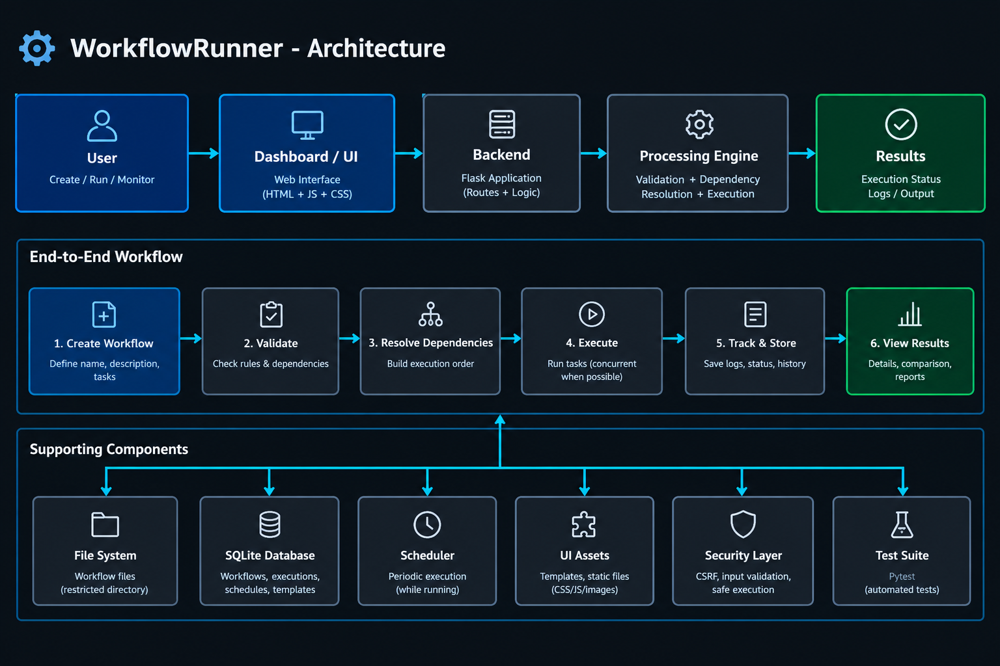
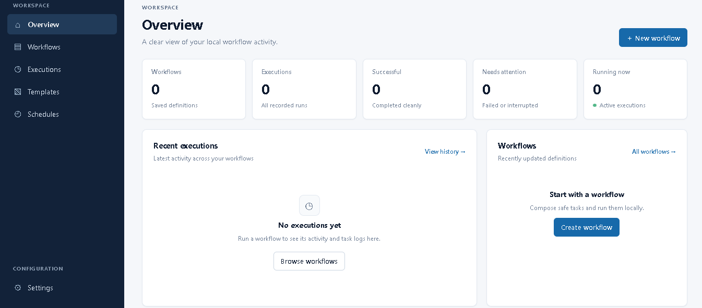
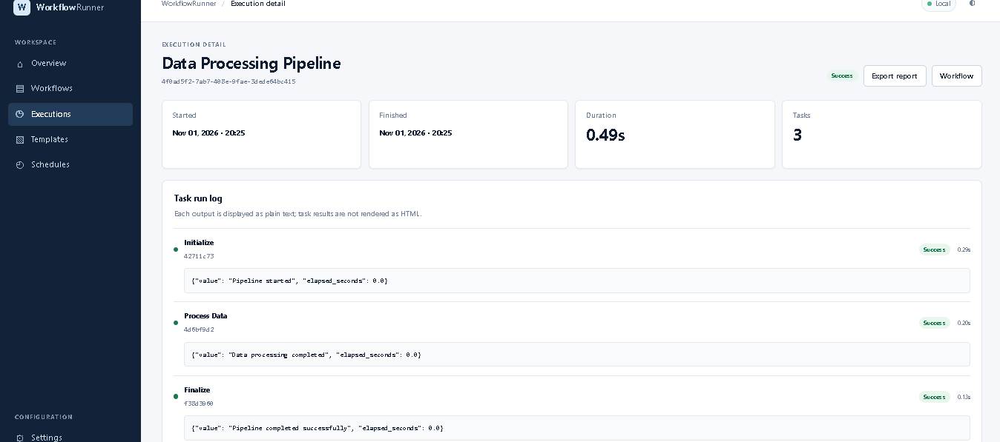
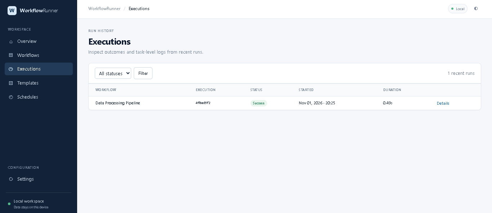
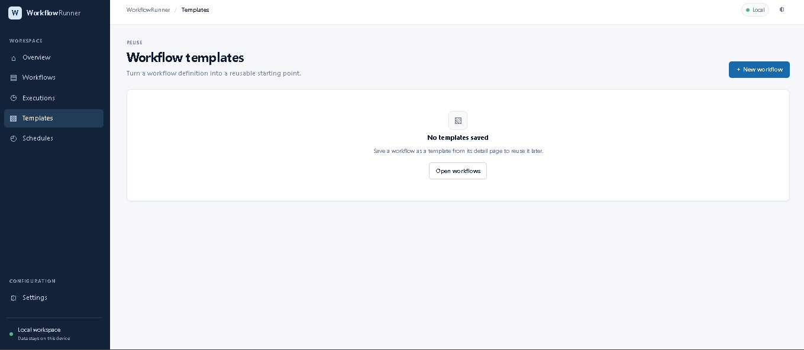
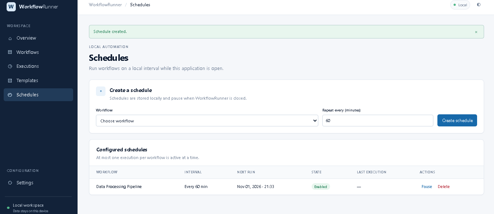
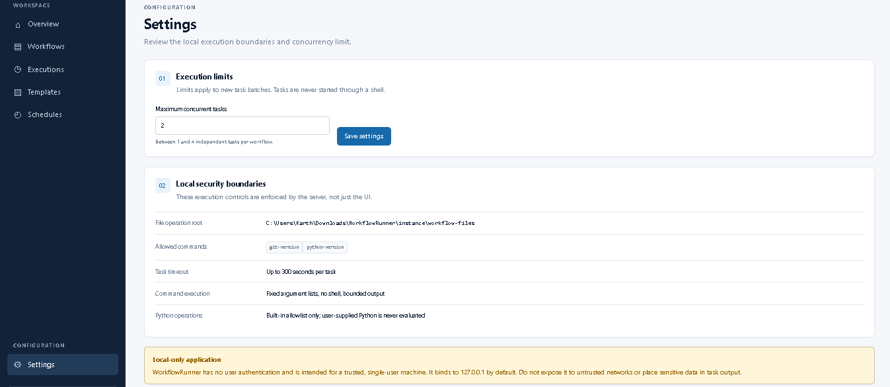

# WorkflowRunner

<p align="center">
  <strong>A local-first workspace for building, running, and understanding workflows.</strong>
</p>

<p align="center">
  
  
  
  
  
</p>

WorkflowRunner is a lightweight, local-first workflow automation application built with Flask, SQLite, HTML, CSS, and vanilla JavaScript.

It provides a structured environment to create workflows, configure tasks, define dependencies, execute operations, and inspect execution results through a browser-based dashboard.

Instead of relying on a hosted automation platform, WorkflowRunner executes workflows locally and stores workflow definitions and execution history on your machine.

> **Designed for a trusted, single-user local machine.** WorkflowRunner binds to loopback by default and keeps its database and permitted workflow files under `instance/`.

---

## Overview

WorkflowRunner brings workflow definition, execution, and monitoring together in one local workspace.

### Key capabilities

- **Workflow Builder** — Create and configure workflows with multiple tasks.
- **Dependency Management** — Define task dependencies and validate workflow execution order.
- **Execution Engine** — Execute independent tasks concurrently with a configurable concurrency limit.
- **Conditional Execution** — Configure conditions to determine whether tasks should run.
- **Retry Handling** — Configure retry attempts and delays for eligible tasks.
- **Execution Monitoring** — Inspect task statuses, execution duration, output, and errors.
- **Execution History** — Review previously completed and failed workflow runs.
- **Execution Comparison** — Compare two executions of the same workflow.
- **Workflow Templates** — Save workflow definitions for reuse.
- **Scheduling** — Configure local interval-based workflow schedules.
- **Import / Export** — Import and export workflow definitions using JSON.
- **Local Persistence** — Store workflows, schedules, and execution records in SQLite.

---

## Workflow Architecture

WorkflowRunner follows a modular architecture that separates user interaction, workflow management, execution processing, and result monitoring.

The application receives workflow definitions through its dashboard, validates task configurations and dependencies, executes eligible tasks, and stores execution results for later inspection.



### Architecture Components

| Component | Responsibility |
|---|---|
| User | Creates, configures, and monitors workflows. |
| Dashboard / UI | Provides the browser-based interface. |
| Backend | Handles application requests and workflow operations. |
| Processing Engine | Validates workflows, resolves dependencies, and executes tasks. |
| Results | Presents execution status, logs, and output. |
| File System | Stores permitted workflow files. |
| SQLite Database | Persists workflows, executions, schedules, and templates. |
| Scheduler | Triggers workflows at configured intervals while the application is running. |
| UI Assets | Provides templates, styles, and browser-side interactions. |
| Security Layer | Enforces input validation, CSRF protection, and safe execution boundaries. |
| Test Suite | Validates application behavior through automated tests. |

### Execution Flow

1. Create a workflow and configure its tasks.
2. Validate the workflow definition and task dependencies.
3. Resolve dependencies and determine the execution order.
4. Execute ready tasks, allowing independent tasks to run concurrently.
5. Track task statuses, output, errors, and execution history.
6. View execution results, compare runs, and export reports.

## Screenshots

### 1. Dashboard

The overview provides a central place to monitor workflow activity, execution statistics, and recent runs.



### 2. Successful Workflow Execution

Inspect a completed workflow execution, including its overall status, duration, and number of tasks.



### 3. Execution History

Review recorded workflow executions, their statuses, start times, and durations.



### 4. Workflow Templates

The template workspace provides an entry point for managing reusable workflow definitions.



### 5. Local Scheduling

Configure interval-based schedules and inspect their next execution time and current state.



### 6. Application Settings

Review execution limits and the local security boundaries enforced by the application.



---

## Technology Stack

| Component | Technology |
|---|---|
| Backend | Python 3.12 |
| Web Framework | Flask 3.1 |
| Database | SQLite |
| Frontend | HTML, CSS, JavaScript |
| UI Rendering | Jinja Templates |
| Testing | Pytest |
| Execution | Python ThreadPoolExecutor |
| Persistence | SQLite |

The frontend uses server-rendered templates and vanilla JavaScript, avoiding a separate Node.js or frontend build pipeline.

---

## Getting Started

### Requirements

- Windows with PowerShell (commands below use PowerShell syntax).
- Python 3.12.
- Git, if you want to use the allowlisted Git version-check operation.

### Installation

Clone the repository and navigate into the project directory:

```powershell
git clone git@github-personal:karthik-k11/WorkflowRunner.git
cd WorkflowRunner
```

Create and activate a virtual environment:

```powershell
py -3.12 -m venv .venv
.\.venv\Scripts\Activate.ps1
```

Install dependencies:

```powershell
python -m pip install -r requirements.txt
```

### Launch the application

```powershell
python app.py
```

Open the application in your browser:

```text
http://127.0.0.1:5000/
```

WorkflowRunner automatically initializes its SQLite database and configured workflow file directory.

If PowerShell prevents virtual environment activation, invoke the interpreter directly:

```powershell
.\.venv\Scripts\python.exe -m pip install -r requirements.txt
.\.venv\Scripts\python.exe app.py
```

---

## How It Works

A workflow consists of uniquely identified tasks. Each task contains its configuration, execution type, timeout, enabled state, and optional dependencies.

A task with dependencies waits until its prerequisite tasks have completed successfully.

### Workflow execution lifecycle

```text
Create Workflow
      |
      v
Configure Tasks
      |
      v
Define Dependencies
      |
      v
Validate Workflow
      |
      v
Build Execution Order
      |
      v
Execute Ready Tasks
      |
      v
Track Task Results
      |
      v
Store Execution History
      |
      v
Inspect Results
```

### Dependency handling

WorkflowRunner validates task dependencies before execution.

It rejects invalid workflow definitions containing:

- Duplicate task IDs.
- Missing dependency references.
- Self-dependencies.
- Circular dependencies.
- Invalid task configurations.
- Invalid output references.

Independent ready tasks can execute concurrently, subject to the configured concurrency limit.

Tasks can also consume values produced by completed prerequisite tasks.

For example:

```json
{
  "from_task": "inspect",
  "path": "text"
}
```

This allows the output of one task to be mapped into another task's configuration.

### Execution behavior

- Tasks execute only after their dependencies are satisfied.
- Independent tasks can run concurrently.
- Failed tasks are recorded with their execution results.
- Tasks depending on failed, blocked, skipped, or cancelled tasks are marked as blocked.
- A workflow succeeds only when no task has failed or been blocked.

---

## Supported Task Types

| Task Type | Available Operations | Description |
|---|---|---|
| Python | `echo`, `add`, `uppercase`, `count` | Executes built-in application-owned operations. |
| File | Check existence, read text, copy text | Performs permitted file operations inside the configured root. |
| Command | Python version, Git version | Executes predefined allowlisted commands. |

### File operation restrictions

File operations are confined to the configured workflow file directory.

Supported file extensions:

- `.txt`
- `.md`
- `.csv`
- `.json`
- `.log`

File reads and copies are limited to 1 MB. File copies do not overwrite existing files.

Arbitrary user-supplied Python code and shell commands are not accepted.

---

## Execution Management

### Retries

Configure the maximum number of attempts and the delay between retry attempts for eligible tasks.

### Conditional execution

Tasks can use supported truthy, falsy, and equality conditions to determine whether they should execute.

### Execution history

Each execution records information such as:

- Workflow and execution identifiers.
- Overall execution status.
- Start and finish timestamps.
- Total execution duration.
- Individual task statuses.
- Task-level execution output and errors.

### Execution comparison

Compare two executions of the same workflow to inspect differences in task status, duration, and output.

### Execution reports

Export workflow execution reports in JSON format.

---

## Scheduling

WorkflowRunner supports local interval-based workflow scheduling.

Users can:

- Select a workflow.
- Configure its execution interval.
- View the next scheduled execution.
- Pause or delete configured schedules.
- Inspect executions triggered by schedules.

**Important:** Scheduling runs only while the WorkflowRunner application is open. It is not a separate background service or a production-grade job scheduler.

---

## Local Configuration and Security

### Default storage locations

```text
instance/
├── workflowrunner.sqlite3
└── workflow-files/
```

The database stores workflow definitions, schedules, and execution history. The workflow file directory is the permitted root for file tasks.

### Environment variables

The database and file root can be configured using environment variables:

```powershell
$env:WORKFLOWRUNNER_DATABASE = "D:\WorkflowRunnerData\workflowrunner.sqlite3"
$env:WORKFLOWRUNNER_FILE_ROOT = "D:\WorkflowRunnerData\files"

python app.py
```

### Security safeguards

WorkflowRunner includes several safeguards for local execution:

- **Loopback binding:** The application binds to `127.0.0.1` by default.
- **CSRF protection:** State-changing forms use session-bound CSRF tokens.
- **File confinement:** File operations are restricted to the configured root.
- **Command allowlisting:** Commands use predefined argument lists and execute without a shell.
- **Execution timeouts:** Tasks have bounded execution time.
- **Output limits:** Task output is bounded.
- **Safe rendering:** Task output is displayed as escaped text.
- **Parameterized SQL:** Database operations use parameterized queries.

> WorkflowRunner is intended for a trusted, single-user local environment. It does not provide user authentication. Do not expose it to untrusted networks or store credentials, private keys, or secrets in workflow configurations or task output.

Cancellation is cooperative: already-running tasks are allowed to finish. If the application exits during execution, unfinished work is marked as interrupted and is not automatically resumed.

---

## Running Tests

Install the project dependencies and run:

```powershell
python -m pytest -q
```

The test suite uses temporary SQLite databases and file roots.

Coverage includes:

- Workflow and task validation.
- Dependency validation and cycle detection.
- Task execution behavior.
- Retry and conditional execution.
- File operation restrictions.
- Command timeouts.
- Execution history.
- Scheduling.
- Import and export.
- Flask routes and CSRF protection.

### Validation

The completed implementation was validated with:

- 17 passing automated tests.
- Python compilation checks.
- JavaScript syntax checks.
- Pylance diagnostics.
- Git diff whitespace checks.

---

## Project Structure

```text
WorkflowRunner/
│
├── app.py
├── config.py
├── database.py
├── requirements.txt
├── README.md
│
├── models/
│   ├── __init__.py
│   ├── workflow.py
│   └── task.py
│
├── services/
│   ├── workflow_validator.py
│   ├── execution_engine.py
│   ├── task_runner.py
│   └── scheduler.py
│
├── templates/
│
├── static/
│   ├── app.js
│   └── styles.css
│
├── tests/
│
├── examples/
│
├── screenshots/
│
└── instance/
```

Runtime data under `instance/` is local application data and should not be committed to the repository.

---

## Troubleshooting

| Problem | Suggested action |
|---|---|
| Port 5000 is already in use | Stop the other local service or configure another port while keeping loopback binding. |
| Workflow import is rejected | Check task IDs, dependencies, task settings, output mappings, and import size. |
| File task cannot find a file | Verify that the file exists inside the configured workflow file root. |
| Scheduled workflow did not execute | Ensure WorkflowRunner was running at the scheduled time. |
| Execution was interrupted | Start a new execution; interrupted work is not automatically resumed. |
| Git version operation fails | Verify Git is installed and available in the system PATH. |

---

## Design Goals

WorkflowRunner was built around a few practical design principles:

- Local-first execution and persistence.
- Lightweight dependencies and no separate frontend build system.
- Explicit workflow dependencies and predictable execution.
- Bounded task execution and output.
- Clear execution visibility and debugging information.
- A structured interface for managing workflows locally.

---